# Chinese Mnemonic HSK 1 — Exemplar Kartu & Video 9:16 (Gaya Kaligrafi Kuas / Kaiti)

Showcase exemplar pipeline kartu mnemonik visual bergaya Chineasy (`1080×1920`) dan video animasi YouTube Shorts 9:16 ter-sinkron audio (`20–30 detik`) dalam **Bahasa Indonesia** dan **English**, disertai pelafalan Mandarin asli (`zh-CN-XiaoxiaoNeural`) yang mencakup **seluruh 4 nada Mandarin** (Nada 1, 2, 3, dan 4) pada **9 karakter terverifikasi** (termasuk keluarga penuh `水 + 青 → 清 / 请 / 晴 / 情`).

Seluruh komponen huruf (`休`/`人`/`木`, `息`/`自`/`心`, `清`/`氵`/`青`, `请`/`讠`/`青`, `晴`/`日`/`青`, `情`/`忄`/`青`, `明`/`日`/`月`, `好`/`女`/`子`, `看`/`手`/`目`) — termasuk judul hero, mini-card asal karakter, teks sebaris (`Kaiti SC Bold`), template guratan, animasi urutan guratan 30fps di kotak `米字格`, strip langkah `1..N`, serta ilustrasi AI Chineasy — menggunakan **gaya kaligrafi kuas bulat (`coretan kuas` / Kaiti) yang 100% seragam** tanpa font kotak.

---

## Ringkasan 9 Karakter Terverifikasi (Nada 1 – 4)

| Karakter | Nada | Pinyin | Komponen | Arti (ID / EN) | Kartu Final (ID / EN) | Video 9:16 (ID / EN) |
| :--- | :--- | :--- | :--- | :--- | :--- | :--- |
| **休** | Nada 1 (Datar Tinggi) | `xiū` | `人` + `木` | Istirahat / Bersantai · Rest / Relax | [cards/休.png](cards/休.png) · [cards_en/休.png](cards_en/休.png) | [char_videos/休.mp4](char_videos/休.mp4) (`23.67s`) · [char_videos_en/休.mp4](char_videos_en/休.mp4) (`20.77s`) |
| **息** | Nada 1 (Datar Tinggi) | `xī` | `自` + `心` | Istirahat / Bernapas · Rest / Breath | [cards/息.png](cards/息.png) · [cards_en/息.png](cards_en/息.png) | [char_videos/息.mp4](char_videos/息.mp4) (`24.03s`) · [char_videos_en/息.mp4](char_videos_en/息.mp4) (`20.82s`) |
| **清** | Nada 1 (Datar Tinggi) | `qīng` | `氵` + `青` | Jernih / Bersih · Clear / Pure | [cards/清.png](cards/清.png) · [cards_en/清.png](cards_en/清.png) | [char_videos/清.mp4](char_videos/清.mp4) (`22.89s`) · [char_videos_en/清.mp4](char_videos_en/清.mp4) (`20.77s`) |
| **请** | Nada 3 (Turun-Naik) | `qǐng` | `讠` + `青` | Silakan / Meminta · Please / Invite | [cards/请.png](cards/请.png) · [cards_en/请.png](cards_en/请.png) | [char_videos/请.mp4](char_videos/请.mp4) (`24.89s`) · [char_videos_en/请.mp4](char_videos_en/请.mp4) (`20.59s`) |
| **晴** | Nada 2 (Naik) | `qíng` | `日` + `青` | Cerah (Cuaca) · Sunny / Clear | [cards/晴.png](cards/晴.png) · [cards_en/晴.png](cards_en/晴.png) | [char_videos/晴.mp4](char_videos/晴.mp4) (`23.96s`) · [char_videos_en/晴.mp4](char_videos_en/晴.mp4) (`20.77s`) |
| **情** | Nada 2 (Naik) | `qíng` | `忄` + `青` | Perasaan / Emosi · Feeling / Emotion | [cards/情.png](cards/情.png) · [cards_en/情.png](cards_en/情.png) | [char_videos/情.mp4](char_videos/情.mp4) (`24.80s`) · [char_videos_en/情.mp4](char_videos_en/情.mp4) (`20.47s`) |
| **明** | Nada 2 (Naik) | `míng` | `日` + `月` | Terang / Besok · Bright / Tomorrow | [cards/明.png](cards/明.png) · [cards_en/明.png](cards_en/明.png) | [char_videos/明.mp4](char_videos/明.mp4) (`22.15s`) · [char_videos_en/明.mp4](char_videos_en/明.png) |
| **好** | Nada 3 (Turun-Naik) | `hǎo` | `女` + `子` | Baik / Bagus / Suka · Good / Fine / To Like | [cards/好.png](cards/好.png) · [cards_en/好.png](cards_en/好.png) | [char_videos/好.mp4](char_videos/好.mp4) (`22.43s`) · [char_videos_en/好.mp4](char_videos_en/好.mp4) (`20.73s`) |
| **看** | Nada 4 (Turun Tegas) | `kàn` | `手` + `目` | Melihat / Menonton · To Look / Watch | [cards/看.png](cards/看.png) · [cards_en/看.png](cards_en/看.png) | [char_videos/看.mp4](char_videos/看.mp4) (`20.37s`) · [char_videos_en/看.mp4](char_videos_en/看.mp4) (`20.79s`) |

---

## Preview Kartu Final

### Bahasa Indonesia (`cards/`)
<table>
  <tr>
    <th width="33%">休 (xiū · Nada 1)</th>
    <th width="33%">息 (xī · Nada 1)</th>
    <th width="33%">清 (qīng · Nada 1)</th>
  </tr>
  <tr>
    <td>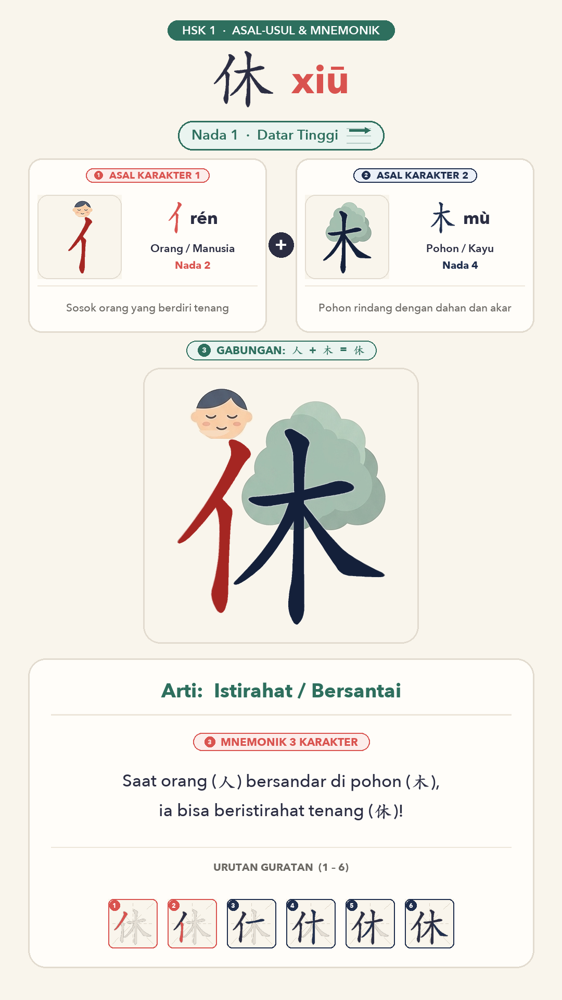</td>
    <td>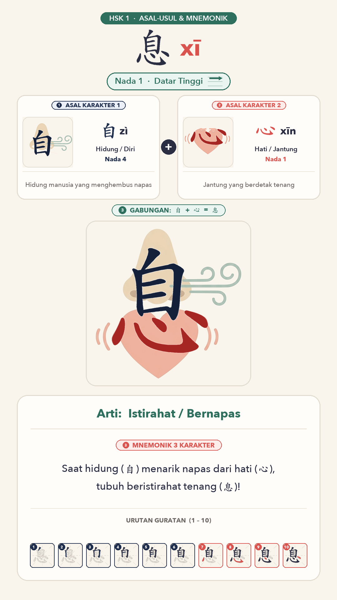</td>
    <td>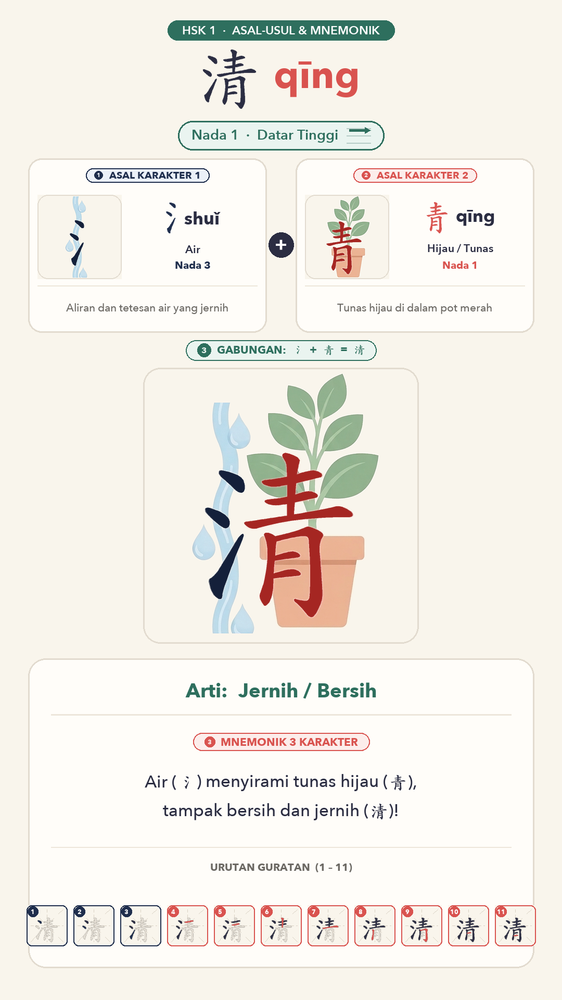</td>
  </tr>
  <tr>
    <th width="33%">明 (míng · Nada 2)</th>
    <th width="33%">好 (hǎo · Nada 3)</th>
    <th width="33%">看 (kàn · Nada 4)</th>
  </tr>
  <tr>
    <td>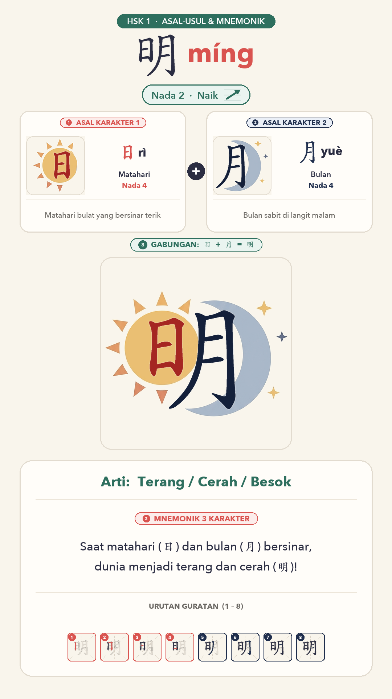</td>
    <td></td>
    <td></td>
  </tr>
</table>

### English (`cards_en/`)
<table>
  <tr>
    <th width="33%">休 (xiū · Tone 1)</th>
    <th width="33%">息 (xī · Tone 1)</th>
    <th width="33%">清 (qīng · Tone 1)</th>
  </tr>
  <tr>
    <td>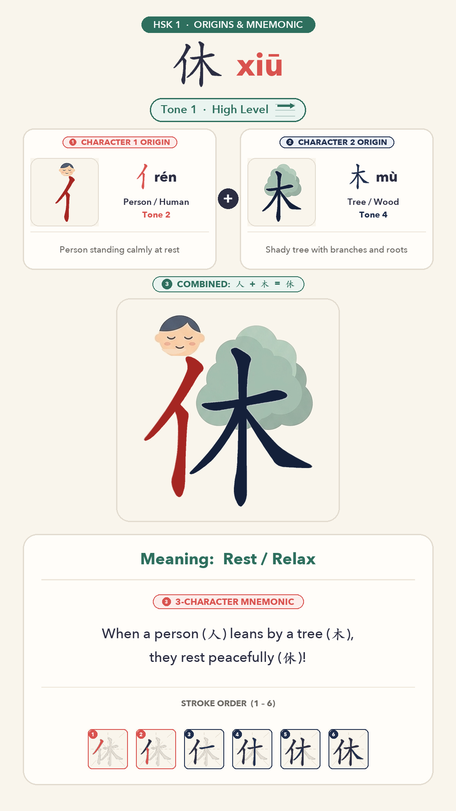</td>
    <td>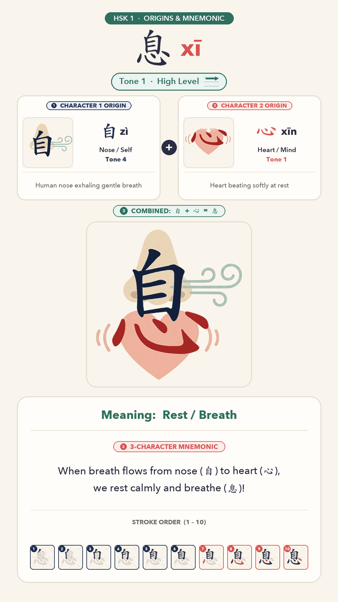</td>
    <td>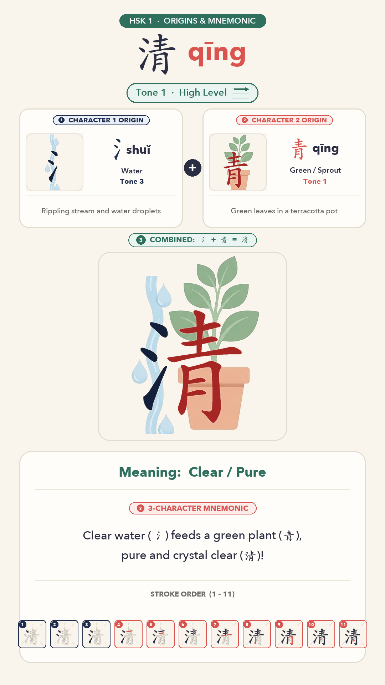</td>
  </tr>
  <tr>
    <th width="33%">明 (míng · Tone 2)</th>
    <th width="33%">好 (hǎo · Tone 3)</th>
    <th width="33%">看 (kàn · Tone 4)</th>
  </tr>
  <tr>
    <td>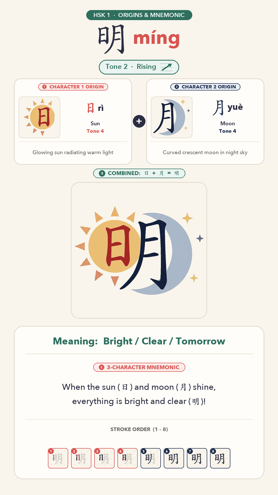</td>
    <td></td>
    <td>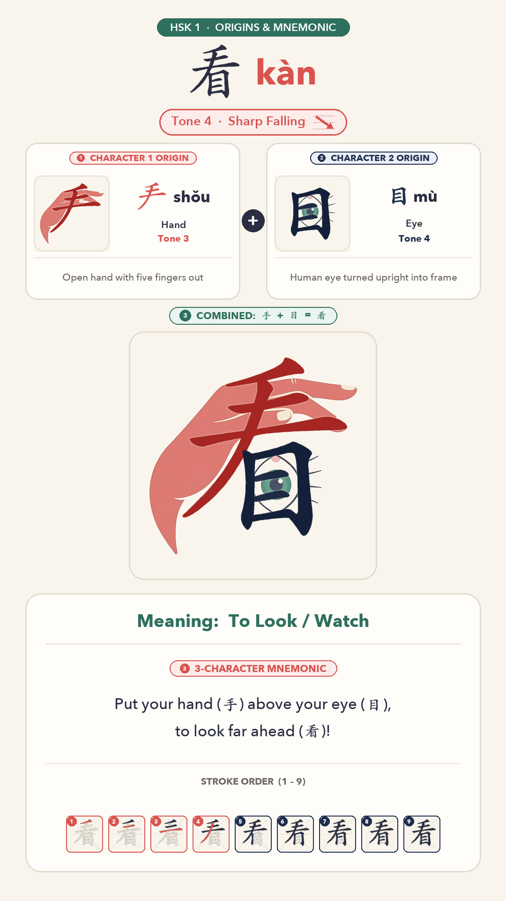</td>
  </tr>
</table>

---

## Alur Koreografi Video 3 Babak & Layering (`Karakter Menimpa Gambar`)

- **Karakter Selalu di Lapisan Teratas (100% Terbaca):** Begitu guratan kuas selesai ditulis, **goresan huruf tetap menimpa di atas gambar ilustrasi** (dengan halo pemisah `#F9F5EC` tipis dan tinta kaligrafi kontras tinggi), sementara ilustrasi AI muncul perlahan di **lapisan belakang** — bebas bayangan karakter ganda.

1. **Babak 1 (`Asal Karakter 1`):** Menggambar guratan resmi (`hanzi-writer-data`) di kotak `米字格` saat karakter dan artinya diucapkan, lalu ilustrasi AI komponen pertama muncul perlahan **di belakang goresan kuas** saat asal piktograf disebut (`人` orang berdiri / `日` matahari cerah / `女` ibu bersimpuh / `手` tangan menaungi).
2. **Babak 2 (`Asal Karakter 2`):** Menggambar guratan komponen kedua secara berurutan lalu ilustrasi AI komponen kedua muncul **di belakang karakter** (`木` pohon rindang / `月` bulan sabit / `子` bayi dibedong / `目` mata manusia yang diputar tegak).
3. **Babak 3 (`Mnemonik 3 Karakter + Menulis & Muncul Bertahap per Bagian`):** Menulis guratan komponen 1 lalu **langsung memunculkan ilustrasi komponen 1 terlebih dahulu** (`Tahap 1A → 1B`, misalnya matahari `日` pada `明`) **sebelum komponen 2 mulai ditulis**; kemudian saat guratan komponen 2 (`月`) digambar, ilustrasi komponen 1 tetap tampil di belakangnya hingga komponen 2 selesai dan memunculkan ilustrasi penuh bersama kartu ringkasan dan strip urutan guratan `1..N`.

### Preview Keyframe Babak 1–3

<table>
  <tr>
    <th>明 · Bagian 1 Selesai + Ilustrasi (日)</th>
    <th>明 · Tulis Bagian 2 (月) saat 日 Muncul</th>
    <th>休 · Bagian 1 Muncul (人)</th>
    <th>休 · Morph Akhir (休)</th>
  </tr>
  <tr>
    <td>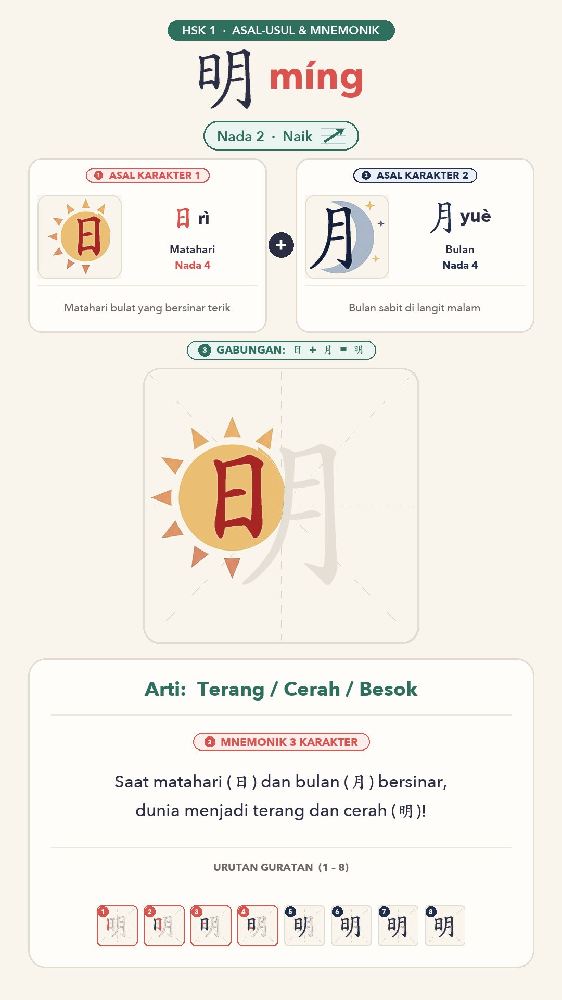</td>
    <td>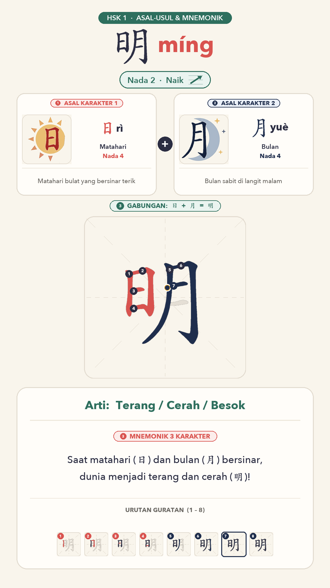</td>
    <td>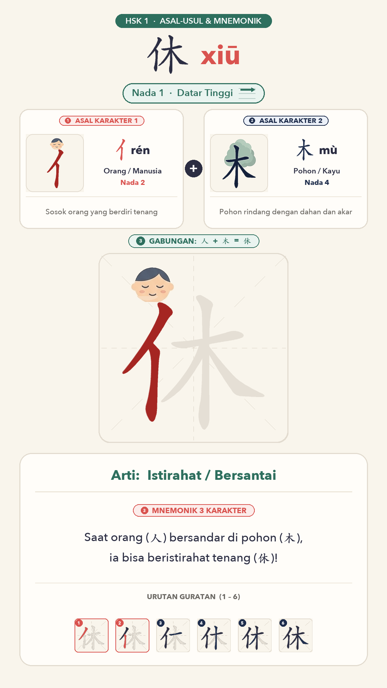</td>
    <td>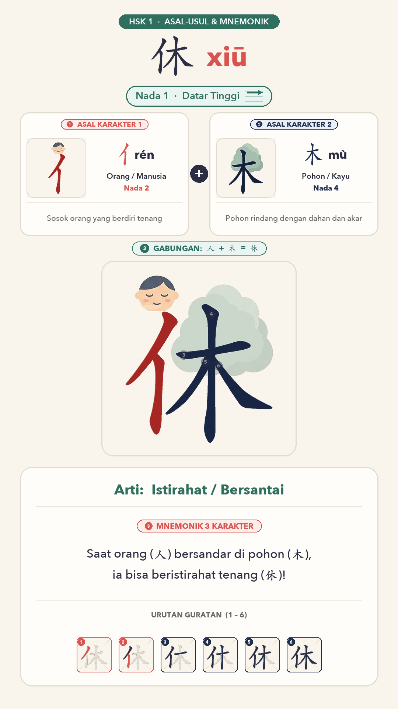</td>
  </tr>
  <tr>
    <th>好 · Bagian 1 Muncul (女)</th>
    <th>好 · Tulis Bagian 2 (子)</th>
    <th>看 · Morph Babak 2 (目 tegak)</th>
    <th>看 · Bagian 1 Muncul (手)</th>
  </tr>
  <tr>
    <td>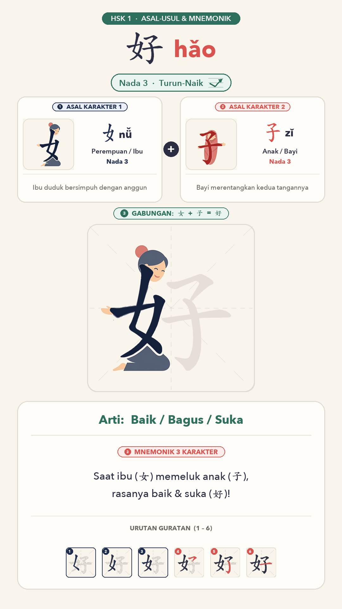</td>
    <td>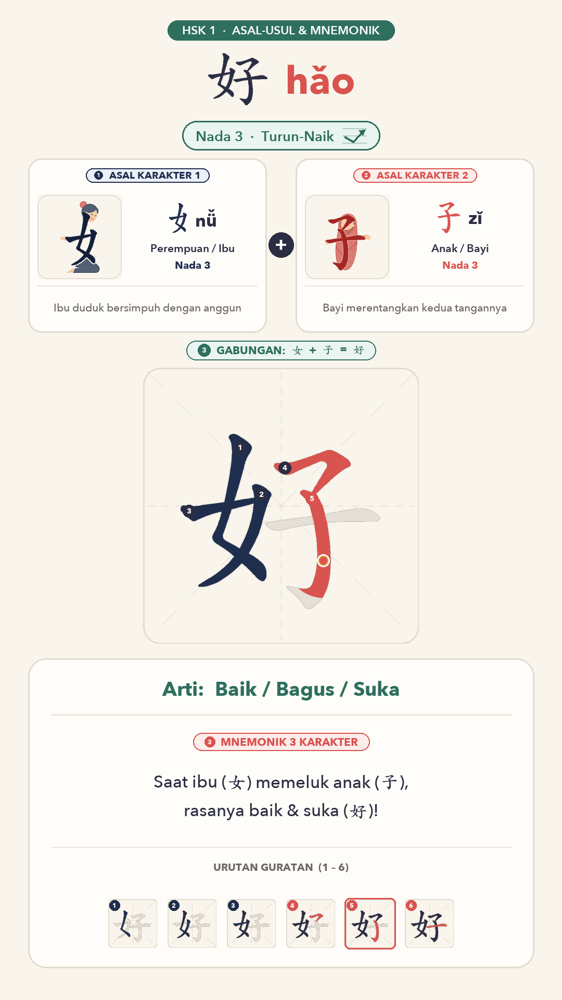</td>
    <td>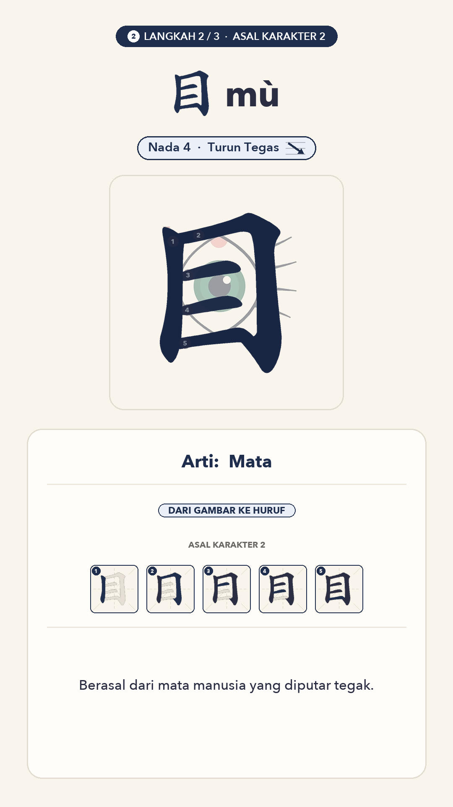</td>
    <td>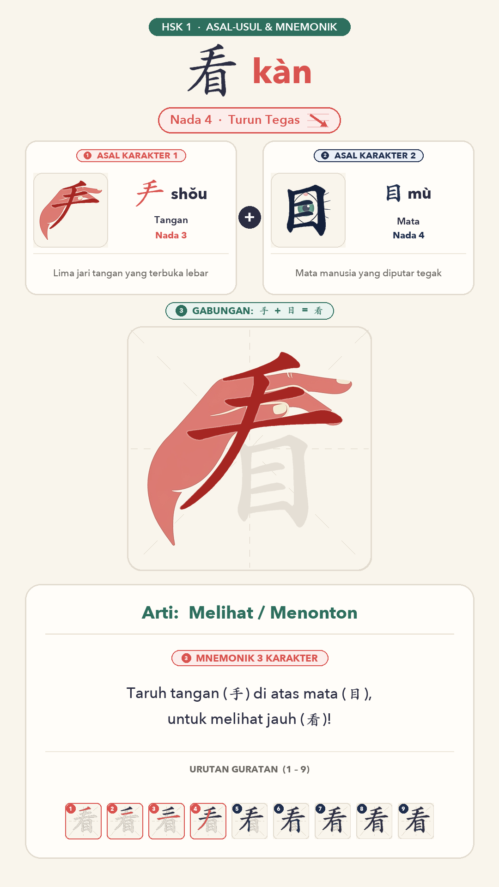</td>
  </tr>
</table>

---

## Dokumentasi QC & Struktur Penting

- **Standar QC lengkap (18 poin akar masalah & aturan wajib):** [DOKUMENTASI_MASALAH_DAN_STANDAR_QC.md](DOKUMENTASI_MASALAH_DAN_STANDAR_QC.md)
- **Skrip exemplar utama:** [build_one_exemplar.py](build_one_exemplar.py)
- **Encoder & concatenator video macOS (`AVFoundation`):** [render_mp4.swift](render_mp4.swift), [concat_mp4.swift](concat_mp4.swift)
- **Data guratan kuas (`hanzi-writer-data@2.0.1`):** [stroke_data/](stroke_data)
- **Template kuas & ilustrasi AI Chineasy:** [templates/](templates), [illustrations/](illustrations)
