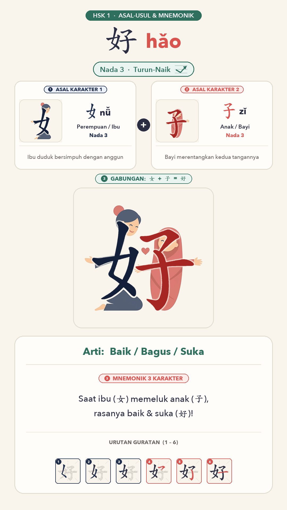
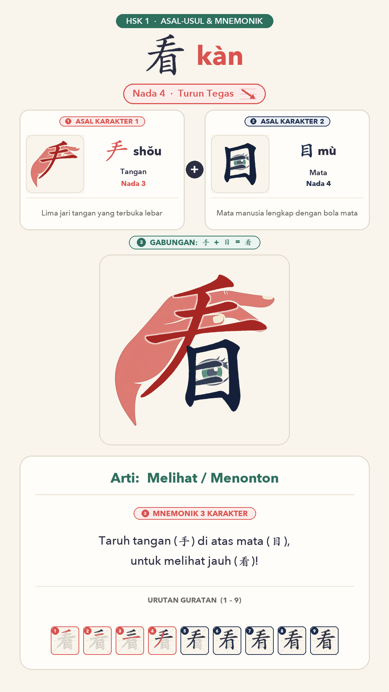
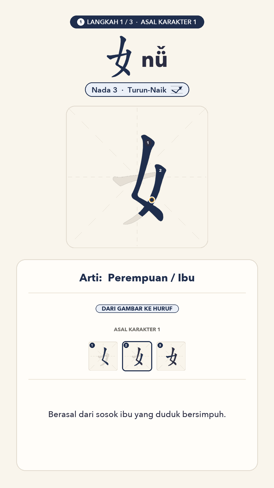
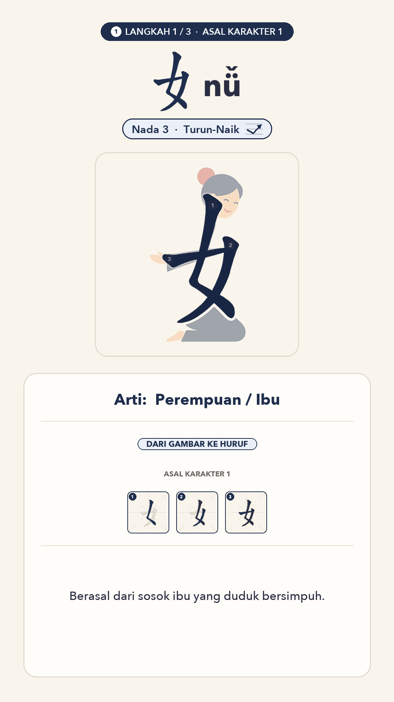
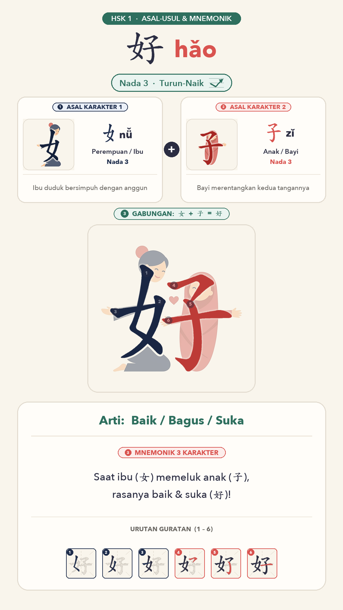
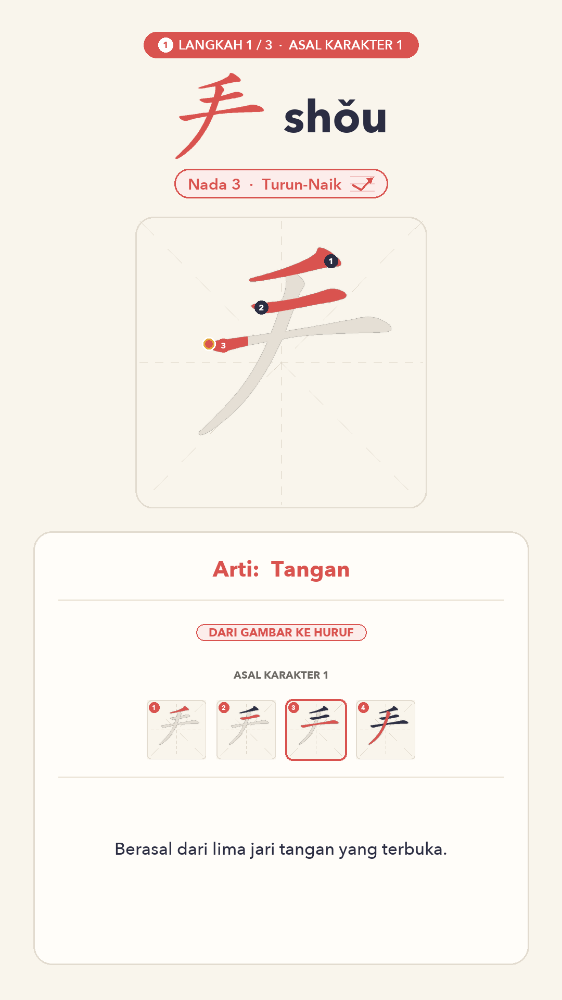
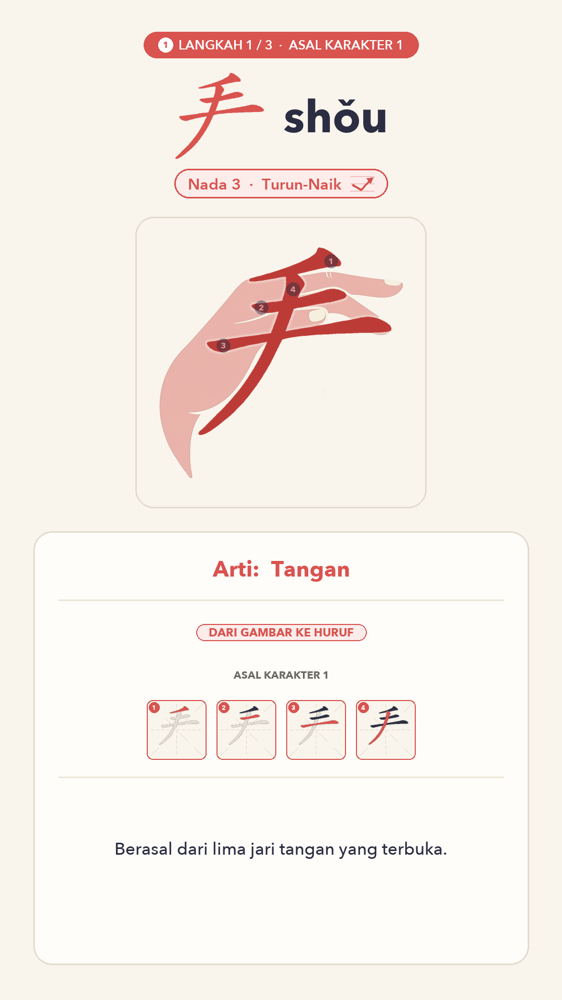
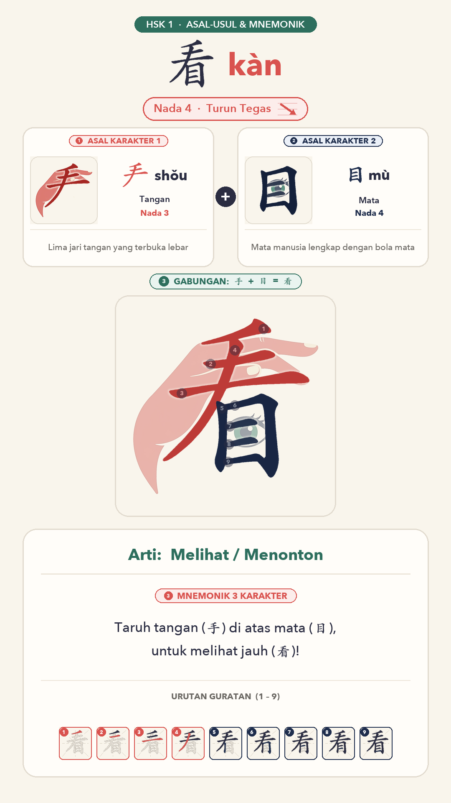

# Chinese Mnemonic HSK 1 — Exemplar Kartu & Video 9:16 (Gaya Kaligrafi Kuas / Kaiti)

Showcase exemplar pipeline kartu mnemonik visual bergaya Chineasy (`1080×1920`) dan video animasi YouTube Shorts 9:16 ter-sinkron audio (`20–30 detik`) dalam **Bahasa Indonesia** dan **English**, disertai pelafalan Mandarin asli (`zh-CN-XiaoxiaoNeural`).

Seluruh komponen huruf (`女`, `子`, `好`, `手`, `目`, `看`) — termasuk judul hero, mini-card asal karakter, teks sebaris (`Kaiti SC Bold`), template guratan, animasi urutan guratan 30fps di kotak `米字格`, strip langkah `1..N`, serta ilustrasi AI Chineasy — menggunakan **gaya kaligrafi kuas bulat (`coretan kuas` / Kaiti) yang 100% seragam** tanpa font kotak.

---

## Ringkasan Exemplar Terverifikasi

| Karakter | Pinyin | Arti (ID / EN) | Kartu Final (ID / EN) | Video 9:16 (ID / EN) |
| :--- | :--- | :--- | :--- | :--- |
| **好** | `hǎo` | Baik / Bagus / Suka · Good / Fine / To Like | [cards/好.png](cards/好.png) · [cards_en/好.png](cards_en/好.png) | [char_videos/好.mp4](char_videos/好.mp4) (`21.69s`) · [char_videos_en/好.mp4](char_videos_en/好.mp4) (`20.73s`) |
| **看** | `kàn` | Melihat / Menonton · To Look / Watch | [cards/看.png](cards/看.png) · [cards_en/看.png](cards_en/看.png) | [char_videos/看.mp4](char_videos/看.mp4) (`20.50s`) · [char_videos_en/看.mp4](char_videos_en/看.mp4) (`20.80s`) |

---

## Preview Kartu Final

<table>
  <tr>
    <th width="25%">好 (ID)</th>
    <th width="25%">看 (ID)</th>
    <th width="25%">好 (EN)</th>
    <th width="25%">看 (EN)</th>
  </tr>
  <tr>
    <td></td>
    <td></td>
    <td></td>
    <td></td>
  </tr>
</table>

---

## Alur Koreografi Video 3 Babak & Layering (`Karakter Menimpa Gambar`)

- **Karakter Selalu di Lapisan Teratas (100% Terbaca):** Begitu guratan kuas selesai ditulis, **goresan huruf tetap menimpa di atas gambar ilustrasi** (dengan halo pemisah `#F9F5EC` tipis dan tinta kaligrafi kontras tinggi), sementara ilustrasi AI muncul perlahan di **lapisan belakang**.

1. **Babak 1 (`Asal Karakter 1`):** Menggambar guratan resmi (`hanzi-writer-data`) di kotak `米字格` saat karakter dan artinya diucapkan, lalu ilustrasi AI komponen pertama muncul perlahan **di belakang goresan kuas** saat asal piktograf disebut (`女` ibu bersimpuh / `手` tangan menaungi).
2. **Babak 2 (`Asal Karakter 2`):** Menggambar guratan komponen kedua secara berurutan lalu ilustrasi AI komponen kedua muncul **di belakang karakter** (`子` bayi dibedong / `目` mata manusia).
3. **Babak 3 (`Mnemonik 3 Karakter + Menulis Utuh`):** Menggambar guratan komponen 1 → komponen 2 secara presisi sinkron mengikuti narasi mnemonik 3 karakter (`Arti → Hanzi`), lalu ilustrasi AI gabungan muncul di belakang goresan kuas bersama kartu ringkasan dan strip urutan guratan `1..N`.

### Preview Keyframe Babak 1–3

<table>
  <tr>
    <th>好 · Tulis Babak 1 (女)</th>
    <th>好 · Morph Babak 1 (女)</th>
    <th>好 · Tulis Babak 3 (好)</th>
    <th>好 · Morph Babak 3 (好)</th>
  </tr>
  <tr>
    <td></td>
    <td></td>
    <td></td>
    <td></td>
  </tr>
  <tr>
    <th>看 · Tulis Babak 1 (手)</th>
    <th>看 · Morph Babak 1 (手)</th>
    <th>看 · Morph Babak 2 (目)</th>
    <th>看 · Morph Babak 3 (看)</th>
  </tr>
  <tr>
    <td></td>
    <td></td>
    <td></td>
    <td></td>
  </tr>
</table>

---

## Dokumentasi QC & Struktur Penting

- **Standar QC lengkap (15 poin akar masalah & aturan wajib):** [DOKUMENTASI_MASALAH_DAN_STANDAR_QC.md](DOKUMENTASI_MASALAH_DAN_STANDAR_QC.md)
- **Skrip exemplar utama:** [build_one_exemplar.py](build_one_exemplar.py)
- **Encoder & concatenator video macOS (`AVFoundation`):** [render_mp4.swift](render_mp4.swift), [concat_mp4.swift](concat_mp4.swift)
- **Data guratan kuas (`hanzi-writer-data@2.0.1`):** [stroke_data/](stroke_data)
- **Template kuas & ilustrasi AI Chineasy:** [templates/](templates), [illustrations/](illustrations)
